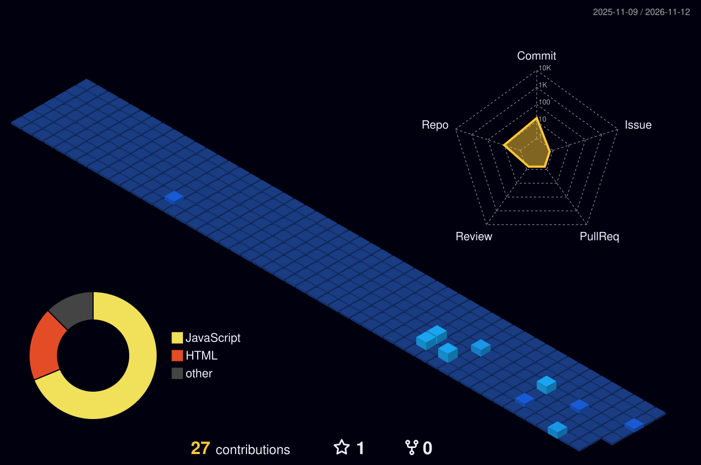

<!-- 🎬 HERO video intro -->

  

 

<!-- 🍥 MY DEVELOPER JOURNEY / NINJA WAY -->

  

<!-- 🔦 TECH ARSENAL / JUTSU STACK -->

  

<!-- 🪪 REGISTRATION + MISSION DASHBOARD -->

  

## 🍥 S-Rank Missions

<table>
<tr><th>Mission</th><th>What it is</th><th>Jutsu used</th><th align="center">⭐</th></tr>
<tr><td><a href="https://github.com/guptaraghvendra17-hue/FitForm-AI"><b>FITFORM AI</b></a></td><td>Production-grade 3D web application for real-time AI exercise form correction &amp; rep counting</td><td><code>MediaPipe</code> <code>React</code> <code>Three.js</code> <code>Python</code></td><td align="center"><b>🔥</b></td></tr>
<tr><td><a href="https://github.com/guptaraghvendra17-hue/TerraWatch-AI"><b>TerraWatch AI</b></a></td><td>3D Space-Tech satellite land monitoring &amp; environmental change detection platform for hackathons</td><td><code>Three.js</code> <code>JavaScript</code> <code>GIS API</code></td><td align="center"><b>🛰️</b></td></tr>
<tr><td><a href="https://github.com/guptaraghvendra17-hue/NutriLens"><b>NutriLens</b></a></td><td>AI nutrition assessment platform analyzing 24-hr dietary recall data against IFCT 2017 &amp; ICMR guidelines</td><td><code>React</code> <code>Node.js</code> <code>Gemini API</code></td><td align="center"><b>🥗</b></td></tr>
<tr><td><a href="https://github.com/guptaraghvendra17-hue/EduPulse"><b>EduPulse AI</b></a></td><td>3D-animated student academic self-improvement platform with personalized study fix recommendations</td><td><code>JavaScript</code> <code>Three.js</code> <code>Gemini API</code></td><td align="center"><b>📊</b></td></tr>
<tr><td><a href="https://github.com/guptaraghvendra17-hue/AirSlice"><b>AirSlice</b></a></td><td>Gesture-controlled browser arcade game powered by MediaPipe Hands AI computer vision in mid-air</td><td><code>MediaPipe</code> <code>Canvas API</code> <code>JavaScript</code></td><td align="center"><b>⚔️</b></td></tr>
<tr><td><a href="https://github.com/guptaraghvendra17-hue/HireReady-AI"><b>InterviewIQ AI</b></a></td><td>Personalized AI-powered mock interview &amp; competency evaluation platform with instant feedback</td><td><code>React</code> <code>Node.js</code> <code>Express</code> <code>NLP</code></td><td align="center"><b>🎯</b></td></tr>
<tr><td><a href="https://github.com/guptaraghvendra17-hue/VocalFly"><b>VocalFly</b></a></td><td>Voice-controlled arcade flight game powered by native Android audio processing &amp; real-time physics</td><td><code>JavaScript</code> <code>Web Audio</code> <code>Android</code></td><td align="center"><b>🦅</b></td></tr>
</table>

<a href="https://github.com/guptaraghvendra17-hue?tab=repositories"><b>→ See all repositories</b></a>

  

### 🌃 My contribution village

*Every commit raises another building — rebuilt automatically every day.*

  

<!-- 💌 JOIN THE SQUAD -->

  

 

**Keep learning, keep building, keep growing.** 🚀

